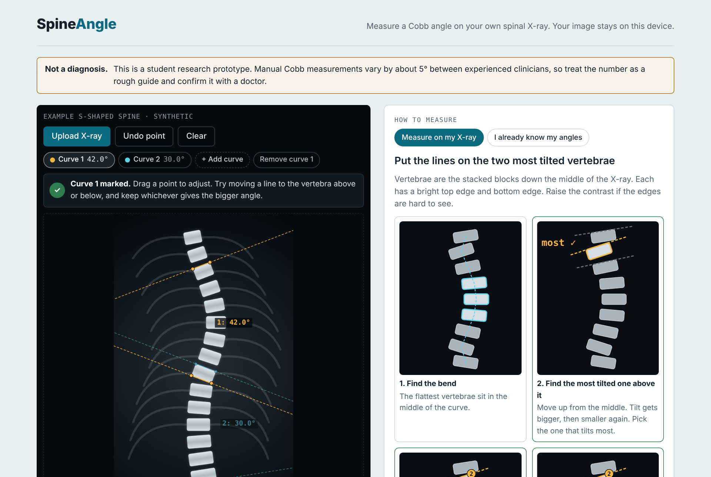
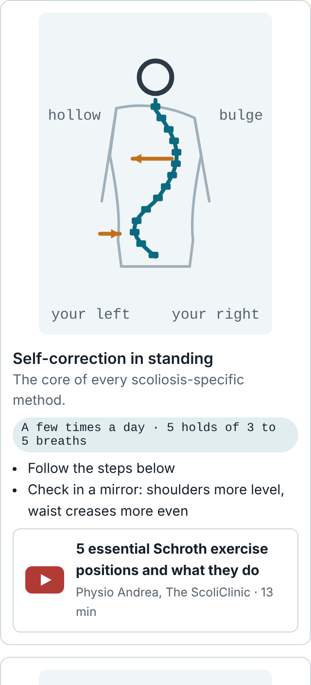
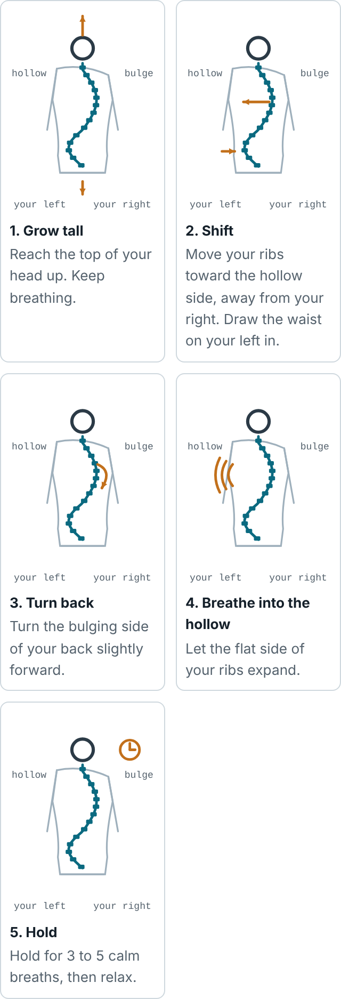

# SpineAngle

Measure a scoliosis Cobb angle on your own X-ray and get an exercise plan for your curve, in the browser. Nothing is uploaded.

**[Try the live demo →](https://nicoleleee8532.github.io/spineangle/)**



> Research and educational prototype. Not a medical device and not a diagnosis. Manual Cobb measurements vary by about 5° even between clinicians, and exercise advice here is general: a physiotherapist trained in scoliosis-specific methods should check it.

## Why I built this

I have scoliosis. After moving to the UK for my MSc, I didn't have easy access to physiotherapy, and I wanted to save money rather than pay privately. Most free advice online ignores the thing that matters most: what kind of curve you have and which way it bends.

So I built the tool I wanted for myself, and for people in the same situation. It measures the Cobb angle on your own X-ray, works out your curve pattern, and turns published physiotherapy research into a plan for that pattern, with drawings instead of walls of text.

It was also a way to build a complete machine learning project end to end on a problem I care about: data, models, evaluation, an API, and a product real people can use. Every exercise and claim in the tool is linked to its source, including where the evidence is weak.

## What it does

**Measure**
- Upload an X-ray, including a phone photo of a hospital screen: it auto-crops to the skeleton.
- **Auto-measure:** tap the top of the shoulders and the top of the hips, and a model trained on 481 real X-rays finds all 17 vertebrae and places the Cobb lines for you. You can drag any point to fix it.
- Or measure by hand: tap two corners on each of the two most tilted vertebrae. A picture guide, a live "tap next" prompt and a magnifier show exactly where.
- Measure up to 3 curves, so S-shaped spines work too. Or type in angles you already know.

**Understand**
- Severity range for the largest curve, with what that range usually means.
- Curve pattern (thoracic, thoracolumbar/lumbar or S-shaped) and which side each curve bulges to, estimated by an ML model from where you tapped.

**Plan**
- A mirror check (rib hump side, waist crease, hip shift, pain, fitness) switches directions to your own left and right and estimates your Schroth curve type.
- Exercises with drawings mirrored to your curve: self-correction, Schroth-style breathing, side plank (lower-back curves only), front plank, bird-dog and glute bridge, with easier versions when needed.
- Videos from scoliosis clinics and therapists, questions to ask a physio, and safety rules.

**Private by design:** everything runs in the browser, including the model (ONNX Runtime Web, 6.7 MB). Your X-ray and measurements are saved only on your device, and one button deletes them.

 

## Try it

Use the [live demo](https://nicoleleee8532.github.io/spineangle/), or open [`index.html`](index.html) in a browser. No install or build step.

## The machine learning

| Part | What | Status |
|------|------|--------|
| Vertebra model (`ml/vertebra.py`, `train_vertebra.py`) | U-Net that finds the 17 vertebra centres (T1–L5) as a heatmap, then regresses vectors to each one's 4 corners, after the strongest AASCE solutions (Yi et al., MICCAI 2020). Trained on AASCE with photo-style augmentation (zoom, tilt, blur, glare, noise) so phone photos of screens work | **Trained and live in the browser** |
| Corner heatmap model (`ml/model.py`, `train.py`) | First attempt: 68 corner heatmaps with soft-argmax | Replaced: too hard to learn from 400 images on CPU |
| Export (`ml/export_onnx.py`) | ONNX with fp16 weights, checked against PyTorch (0.01 px) | Done |
| Cobb geometry (`ml/cobb.py`) | Primary and secondary curves from landmarks; same maths as the browser, checked by tests | Done |
| Curve pattern model (`ml/pattern.py`) | Softmax regression predicting curve region from manual taps only; labels from true vertebra levels | 88.3% test accuracy on synthetic spines vs 84.9% for a height rule; retrain on AASCE |
| Auto-crop (`ml/autocrop.py`, in the browser too) | Finds the skeleton in a photo of a screen: bright, grey, textured pixels, minus flat UI, toolbars and thin edges | Done |
| Inference API (`ml/api.py`) | FastAPI endpoint returning landmarks, confidence, curves and a low-confidence flag | Done |

33 tests cover the geometry, torch/numpy/JavaScript agreement, augmentation, curve patterns and API errors.

```bash
cd ml
pip install -r requirements.txt
pytest -q                                   # 33 tests

# smoke run on synthetic spines, about a minute on CPU
python train.py --synthetic 24 --epochs 2 --base 8 --workers 0 --out checkpoints
python evaluate.py --weights checkpoints/best.pt --synthetic 4

# curve pattern model
python pattern.py --synthetic 3000 --out pattern_model.json
```

### Training on real data

1. **Get the data.** Register for the AASCE 2019 challenge dataset (SpineWeb, dataset 16: 609 frontal X-rays with 68 landmarks and 3 Cobb angles each). Don't commit the images.
2. **Check the label format.** `dataset.read_aasce` expects `labels/<split>/landmarks.csv` with 68 x values then 68 y values per row, normalised to [0, 1]. Plot one image's landmarks before training.
3. **Train on a GPU** (Bristol's HPC or Google Colab):

   ```bash
   python train.py --data /path/to/boostnet_labeldata --epochs 150 --batch 4 --base 32
   python train.py --data ... --epochs 30 --cobb-weight 0.1 --lr 1e-4   # fine-tune on the Cobb loss
   python evaluate.py --weights checkpoints/best.pt --data /path/to/boostnet_labeldata --plot
   ```

   Targets from `DESIGN.md` §7: Cobb MAE ≤ 5°, SMAPE ≤ 10%.

4. **Serve it:** `SPINEANGLE_WEIGHTS=checkpoints/best.pt uvicorn api:app --port 8000`

### Results

On the 128 AASCE test X-rays the model never saw during training (base 16, 3.3M parameters, 50 epochs on 2 CPU cores):

| Metric | Result |
|--------|--------|
| Landmark error | 3.3% of image height |
| Cobb MAE, official AASCE formula (curve 1 / 2 / 3) | 3.3° / 4.5° / 4.9° |
| Challenge SMAPE | 9.1% (target ≤ 10%) |
| Largest curve within 5° | 77% |
| App's endplate method: MAE, within 5° / 10° | 4.3°, 67% / 95% |
| Severity band matches the label | 84% |

For scale, two doctors measuring the same X-ray typically differ by about 5°. On my own X-ray (a phone photo of a hospital screen) it measured 41° against the doctor's 37.5°.

The model is a research project, not a medical device: always check the lines it places, and rely on your doctor's measurement.

Data: AASCE 2019 challenge (Wu et al., *Automatic landmark estimation for adolescent idiopathic scoliosis assessment using BoostNet*, MICCAI 2017), used for research only and not included in this repository.

## Docs

- [`DESIGN.md`](DESIGN.md): requirements, architecture, API contract, trade-offs and what to revisit
- [`docs/EXERCISE_EVIDENCE.md`](docs/EXERCISE_EVIDENCE.md): the research behind every exercise and rule, including weak and mixed evidence

## Repository layout

```
index.html           the tool, ready to open (generated from web/index.html)
web/index.html       the tool's source
ml/                  models, training, evaluation, API, auto-crop, tests
docs/                evidence notes and screenshots
DESIGN.md            system design
```

## Roadmap

- Train a larger model on a GPU
- Validate on a second dataset, and add uncertainty to the angle

Built by Nicole Lee En Xin, MSc AI, University of Bristol.
